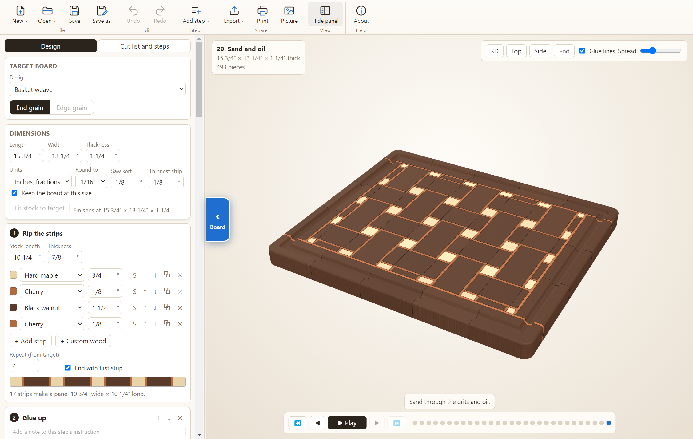
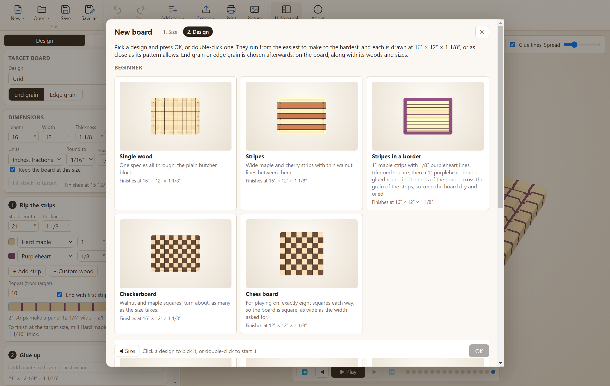
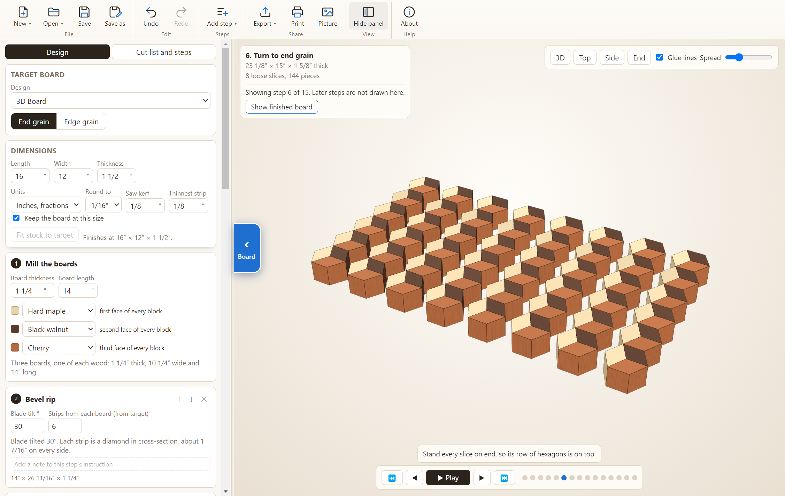
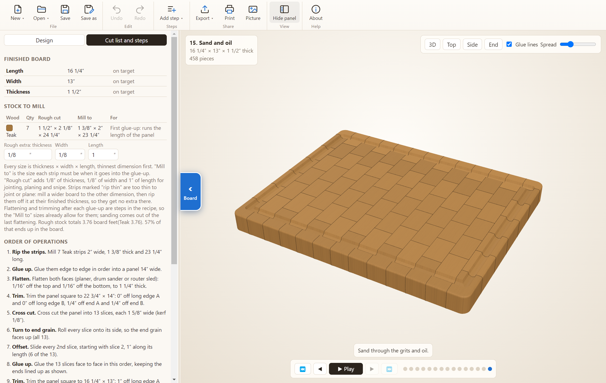

# Cutting Boards

Design a cutting board before you cut any wood. Pick a pattern and a size, choose your woods, and
the app shows the board in 3D at every stage of the build, then writes the list of stock to mill
and step-by-step instructions you can take to the shop.

**Use it now, with nothing to install: <https://boards.longshotsw.com>**



It runs in any modern browser, on a computer, a tablet or a phone. There is also a desktop app for
Windows, with an installer, that keeps your designs as files ([Install the desktop app](#install-the-desktop-app)).

> The sizes and steps are worked out by software, and no board has yet been built from them.
> Check every measurement against your own stock and tools before you cut.

## Contents

- [Your first board, in five minutes](#your-first-board-in-five-minutes)
- [The window](#the-window)
- [Set the size and how sizes are written](#set-the-size-and-how-sizes-are-written)
- [Choose the woods and strips](#choose-the-woods-and-strips)
- [Watch the build](#watch-the-build)
- [Change the recipe](#change-the-recipe)
- [Finishing touches and feet](#finishing-touches-and-feet)
- [Take it to the shop: cut list, print, PDF](#take-it-to-the-shop-cut-list-print-pdf)
- [Save, open and share designs](#save-open-and-share-designs)
- [On a phone or tablet](#on-a-phone-or-tablet)
- [The designs](#the-designs)
- [Build your own pattern from nothing](#build-your-own-pattern-from-nothing)
- [Keyboard shortcuts](#keyboard-shortcuts)
- [Install the desktop app](#install-the-desktop-app)
- [Reference: everything it does](#reference-everything-it-does)
- [Known limits](#known-limits)
- [For developers](#for-developers)

## Your first board, in five minutes

1. Open <https://boards.longshotsw.com>. A board is already on screen; you can change it, or
   start a new one.
2. Click **New**, then **Board wizard…**.
3. **Page 1, Size.** Type the length, width and thickness you want the finished board to be, then
   press **Next: design**.
4. **Page 2, Design.** Every pattern is drawn at your size, easiest first, under Beginner,
   Intermediate and Advanced. Click one and press **OK**, or double-click it.

   

5. The board opens. On the left, under **Target board**, choose **End grain** or **Edge grain**.
6. Under **Rip the strips** (step 1), change the woods to the ones you have.
7. Press **Play** under the board to watch it being built, one operation at a time.
8. Click **Instructions** in the toolbar for the stock to mill and the written instructions.
9. Click **Print** to print them, or **Export** for a PDF with a picture of every step.

That is the whole loop. The rest of this page explains each part.

## The window

| Part | Where | What it is for |
| --- | --- | --- |
| Toolbar | Along the top | **New**, **Open**, **Save**, **Save as**; **Undo**, **Redo**; **Add step**; **Export**, **Print**, **Picture**; **Instructions**, **Hide panel**; **About**. |
| Side panel | Left | Two views, swapped with **Instructions** in the toolbar, which is in reach however far down the panel is scrolled. The design is where you change the board. The cut list and steps are what you take to the shop; the button then reads **Design** and takes you back. |
| The board | Right | The board in 3D, as the selected step leaves it. |
| Step card | Top left of the board | The step being shown, the size it leaves, and how many pieces. |
| View buttons | Top right of the board | **3D**, **Top**, **Side**, **End**; **Glue lines** on or off; **Spread** pulls the pieces apart so you can see them. |
| Player | Under the board | **Play**, back and forward one step, jump to the start or the end, and a dot for every stage. |

The design reads from top to bottom in the order you work:

1. **Target board**: which design, and which grain is on top.
2. **Dimensions**: the finished size, the units, and your saw.
3. **The steps**, numbered. Step 1 is always the strips. Click any step to see the board as that
   step leaves it.
4. **Finishing**: rounded corners, chamfer, round-over, juice groove, feet.

Drag the bar between the panel and the board to make the panel wider or narrower.
Anything you change can be undone with **Undo** (Ctrl+Z).

## Set the size and how sizes are written

Everything here is in the **Dimensions** card. Set the units first: they say what a number you
type means. A size typed
here is taken up when you press Enter, leave the box, or click anywhere else, the board included;
not while you are still typing it.

- **Units**: inches as fractions, inches as decimals, or millimetres, like the modes of a
  caliper. Every size on screen and on paper is written that way, and every size box is in those
  units: in inches you can type shop fractions (`1 1/8`, `3/4`), in millimetres you type
  millimetres. A size typed in the other units is converted: type `43mm` into a board in inches
  and the box changes it to `1.693`; type `3/4"` into a board in millimetres and it becomes
  `19.05`.
- **Length, Width, Desired thickness**: the size the finished board should be. With
  **Keep the board at this size** ticked (it starts ticked), the app works out how many strips
  and how much stock are needed, and works them out again whenever you change something. The line
  beside it, "Finishes at…", is the size the recipe really ends at.
- **Starting thickness**: how thick your wood is when it goes into the first glue-up. It is the
  wood you have, and on an edge-grain board the app never changes it to suit the thickness you
  want. Each flattening is an allowance of one rounding step off the thickness: its instruction
  says to take only what the glue-up needs to come flat, up to that much. So flat stock 2″
  thick, rounding to 1/8″, in a board with two glue-ups comes out 1 3/4″. If that is over the
  thickness you want, the last flattening's instruction says by how much and to keep going down
  to it; if it is under, it says so, and the board is made all the same. The step that mills
  the wood says how many flattenings there are and what they leave. How much really comes off
  depends on how flat your glue-ups are, and nobody can tell 1 1/2″ from 1 7/16″ in a finished
  board. On an end-grain board the slices are
  stood on end, so the wood's thickness becomes the length of each block and the board's
  thickness is how wide the slices are cut.
- **Round to**: the finest step you can actually cut to, such as 1/16″ or 0.5 mm. Every size in
  the instructions is rounded to it, and the board drawn is built from those rounded sizes, so
  what you read is what you get. Choose **Exact** for no rounding.
- **Saw kerf**: how thick your blade cuts (1/8″ to start with). Every cut allows for the wood the
  blade turns to dust.
- **Thinnest strip**: the thinnest piece your planer or sander can handle. A step that needs
  anything thinner is flagged. Set it to 0 to turn the check off.

To change the board to a different pattern at the same size, pick another one from **Design** in
the **Target board** card. **End grain / Edge grain** in the same card turns the board round: end
grain is kinder to knives; edge grain uses thinner stock and is simpler to make.

## Choose the woods and strips

Step 1, **Rip the strips**, is the first glue-up: the strips laid side by side.

- Each row is one strip: its **wood** and its **width**. The buttons at the end of a row move it
  up or down, copy it, or remove it. **S** marks it a spacer: a cheap strip that is sawn out later
  to leave a gap for an accent.
- **+ Add strip** adds a row. **+ Custom wood** adds a species that is not in the list, with a
  colour you pick.
- **Stock length** and **Thickness** are the size of the strips before the first cut.
- **Repeat** is how many times the set of strips repeats across the board, and
  **End with first strip** adds one more of the first strip so the panel is symmetric. While the
  board is held at its size, the app sets the repeat and the stock length for you.
- The coloured bar under the rows shows the panel the strips make, and the line under it says how
  many strips and how big.

## Watch the build

- **Play** runs the whole build as an animation. The arrows beside it go back and forward one
  operation; the outer buttons jump to the first step and to the finished board.
- Click a step on the left, or a dot under the board, to stop on that step. The card at the top
  left says which step you are on, and **Show finished board** takes you back to the end.

  

- Drag on the board to turn it. Scroll, or pinch, to zoom. **Top**, **Side** and **End** look
  straight on; **3D** goes back to the angled view.
- Hold the pointer over a piece to see its wood, its size and which way its grain runs.
- The line above the player is the instruction for the step on screen.

Each stage is one operation at the bench: mill, glue, cut, turn, place. Nothing smaller than a
strip or a slice of a panel is ever handled on its own.

## Change the recipe

A board is a list of steps, and you can change the list.

- **Change a step**: click its card and edit its fields: how wide the slices are, the angle of a
  cut, how far to slide, how much to trim. Every card has a line for a note of your own, which is
  added to that step's instruction.
- **Add a step**: click the step it should follow, then **Add step** in the toolbar, and choose
  from the menu. Steps that do not fit there are greyed out and say what they need.
- **Move or remove a step**: the arrows and the ✕ at the top right of its card.
- For **Turn**, **Flip** and **Offset**, click slices in the 3D view to choose which ones the
  step applies to.

The steps you can add:

| Step | What it does |
| --- | --- |
| Cross cut | Cuts the panel into slices, square or at an angle. |
| Rip the panel | Saws the panel lengthways into strips. |
| Turn to end grain | Rolls slices 90° so the end grain faces up. |
| Flip | Turns slices end for end, or face down. |
| Offset | Slides slices along their length (brick, steps). |
| Insert accent strips | Adds thin strips between the slices. |
| Glue up | Glues the slices into a new panel. |
| Trim | Squares up the edges. |
| Flatten | Takes a little off both faces. |
| Quarter-turn panel | Turns the panel 90° so the next cut is a rip. |
| Add a border | Glues a frame round the panel, with a thin line inside it if you like. |
| Start another panel | Sets the slices aside and glues up a second panel, for a pattern one panel cannot make. |
| Interleave the slices | Brings back the slices set aside and puts a new slice after each. |

If a step cannot be done (a cross cut with nothing glued yet, a strip thinner than your planer
allows), its card says so in plain words and the board is drawn up to the step before.

## Finishing touches and feet

Under the steps are the finishing cards. Each is off until ticked, has its own sizes, and becomes
a numbered step with its own picture and instruction:

- Round the corners.
- Chamfer the bottom edges.
- Round over the top edges.
- A juice groove in the top: the width of the router bit, the depth, and how it turns the corners.
- **Add the feet**: a round foot under each corner, sized for the common screw-on brass-and-rubber
  feet (0.82″ across, 0.35″ tall, 1″ in from each edge). All three sizes can be changed.

**Sand and oil** is always the last step before the feet.

## Take it to the shop: cut list, print, PDF

Click **Instructions** in the toolbar.



- **Finished board**: the size the recipe ends at, against the size you asked for.
- **Stock to mill**: for each wood, how many pieces, the size to **rough cut** them and the size
  to **mill** them to. Sizes are thickness × width × length. The **Rough extra** boxes set how
  much you allow for jointing, planing and snipe. Underneath are the board feet and how much of
  the wood ends up in the board.
- **Order of operations**: the numbered instructions, one operation each.

To get it on paper:

- **Print** (Ctrl+P) shows the sheet as it will print. Tick **Show a picture of each step** to
  put a drawing beside every instruction.
- **Export → PDF: cut list and steps…**, or **PDF with a picture of each step…**.
- **Picture** saves the view of the board as a PNG image.

## Save, open and share designs

- **Save** (Ctrl+S) keeps the design under its name. **Save as** (Ctrl+Shift+S) gives it a new
  name. **Open** lists what you have saved; the ✕ beside one deletes it.
- A design names itself from its woods and pattern ("Hard maple and black walnut grid") until you
  save it or name it yourself.
- **In the browser**, designs are saved *in that browser on that device*. They are not uploaded
  anywhere, nobody else can see them, and they are not on your other devices. Clearing the
  browser's site data removes them, and an iPhone or iPad can clear them after a week or so without a visit.
  The board you are working on is remembered between visits even if you never press Save.
- **To keep a design safely, or move it to another device or person**, use
  **Export → Design file (.board.json)…**, and bring it back with
  **Open → Import a .board.json file…**.
- **In the desktop app**, Save writes a file in `Documents\Cutting Boards` (in the project's
  `designs` folder when run from the source), and **Open → Show the designs folder…** opens it.

## On a phone or tablet

Open the same address. On a narrow screen the side panel starts hidden so the board has the whole
screen:

- The blue **☰ Edit** tab on the left edge opens the panel.
- The blue **Show the board ›** bar along the bottom goes back to the board.
- Drag with one finger to turn the board; pinch to zoom.

On an iPhone or iPad, **Share → Add to Home Screen** makes it open like an app. Designs saved
there are kept separately from the ones saved in Safari, so export any you want to carry over.

## The designs

| Level | Design | What it is |
| --- | --- | --- |
| Beginner | Single wood | One species all through: the plain butcher block. |
| Beginner | Stripes | Wide strips of two woods with thin lines of a third between them. |
| Beginner | Stripes in a border | Striped panel with a border glued round it. |
| Beginner | Checkerboard | Squares of two woods, turn about, as many as the size takes. |
| Beginner | Chess board | Exactly eight squares each way, so the board is square. |
| Intermediate | Brick | One species; every other row slides half a block, like brickwork. |
| Intermediate | Grid | Squares of one wood with thin lines of another both ways. |
| Intermediate | Chevron | Three woods cut at an angle and flipped into zigzags. |
| Advanced | Double border | Blocks each ringed with a second wood, in a grid of a third. Three glue-ups. |
| Advanced | Basket weave | Bars woven over and under, with a square at every crossing. Two panels. |
| Advanced | 3D Board | Tumbling blocks: diamonds in three woods that read as stacked cubes. |

Every design can be made end grain or edge grain except basket weave and chevron. All of them are
also listed under **New** at a default size, and each is only a starting point: change its woods,
sizes and steps as you like.

## Build your own pattern from nothing

**New → Custom** starts a board with only the strips and their glue-up: no pattern, no finishing.
Set up the strips in step 1, then build the rest with **Add step**. A checkerboard, for example:

1. In step 1, two strips of different woods, the same width.
2. **Add step → Cross cut**, with slices as wide as the strips.
3. **Add step → Turn to end grain** (leave this out for an edge-grain board).
4. **Add step → Flip**, applied to every other slice.
5. **Add step → Glue up**, then **Trim** and **Flatten**.

Every design in the table above can be built this way, step by step.

## Keyboard shortcuts

| Keys | What it does |
| --- | --- |
| Ctrl+S, Ctrl+Shift+S | Save; Save as |
| Ctrl+Z, Ctrl+Y | Undo; Redo |
| Ctrl+P | Print preview |
| Ctrl+B | Hide or show the side panel |
| Space | Play or pause the build |
| Left, Right | Back or forward one step |
| Up, Down in a size box | Nudge the size by 1/16″, or by 1 mm when the units are millimetres |
| Esc | Close a dialog |

## Install the desktop app

The desktop app is the same program in its own window, with designs saved as files on your
computer.

### On Windows, with the installer

1. Go to the [Releases page](https://github.com/joelong01/Cutting-Boards/releases) and download
   `Cutting-Boards-Setup-<version>.exe` from the newest release.
2. Run it. Windows will show a blue box saying **Windows protected your PC**, because the
   installer is not signed with a paid certificate. Click **More info**, then **Run anyway**.
3. It installs for you alone, with no administrator password, and opens the app when it is done.

After that, open it from the Start Menu as **Cutting Boards**.

- **Your designs** are saved in `Documents\Cutting Boards`, one `.board.json` file each, so they
  can be backed up, copied or sent like any other file.
- **To update**, download and run the newer installer. It replaces the old version and keeps your
  designs.
- **To remove it**, use **Settings → Apps → Installed apps → Cutting Boards → Uninstall**. Your
  designs are left where they are. So is a small settings folder, `%APPDATA%\cutting-boards`,
  which remembers the board you had open; delete it by hand if you want nothing left.

Windows 10 or 11, 64-bit. There is no installer for macOS or Linux yet: use the browser version,
or run it from the source.

### On any system, from the source

You need [Node.js](https://nodejs.org) 22 or newer and [Git](https://git-scm.com).

```sh
git clone https://github.com/joelong01/Cutting-Boards.git
cd Cutting-Boards
npm install
npm start
```

`npm start` builds the app and opens it. Run this way, designs are saved in the `designs` folder
of the project.

- **On Windows** the app adds itself to the Start Menu as **Cutting Boards**, unless the installed
  app is already there. The shortcut opens the last build, so run `npm start` once after
  updating. To remove it, delete
  `%APPDATA%\Microsoft\Windows\Start Menu\Programs\Cutting Boards.lnk`.
- **To update**, run `git pull`, then `npm install`, then `npm start`.
- If `npm install` reports that Electron's install script was skipped, run
  `node node_modules/electron/install.js` once.

To use the browser version from your own machine instead of the public site, run `npm run web`.

## Reference: everything it does

The sections above are the directions. This is the full list, for looking things up.

- **Toolbar.** Along the top, laid out like an Office ribbon: groups of buttons (File, Edit,
  Share, View), each button an icon over its label. The design's name is in the window's title
  bar; **Save as** (Ctrl+Shift+S) gives it a new name. It is the same in the
  desktop app and the web page; on a phone the buttons shrink to one row and lose the group names.
- **Hide the panel.** **Hide panel** in the toolbar, the blue **‹ Board** tab beside the panel,
  or Ctrl+B gives the 3D view the whole window; **Show panel** or the blue **☰ Edit** tab brings the side panel back. On a phone-width screen the panel starts hidden and,
  when shown, takes the whole width, so the toggle switches between editing and the board; the
  tab then becomes a **Show the board ›** bar along the bottom, clear of the panel's controls, so
  there is always something on screen to tap.
- **Grain switch.** **End grain / Edge grain** in the Target board card turns the open board
  round, keeping its woods, pattern and size: end to edge takes out the turn step and mills the
  stock to the board's thickness; edge to end cuts and stands the slices up. Greyed out for
  basket weave and chevron, which cannot be turned round. On the 3D board it swaps the whole
  recipe for the other one.
- **Target board.** The first tile: which design the board is, in a dropdown of every design on
  offer, and the grain switch. The designs are listed easiest first, under Beginner, Intermediate
  and Advanced, here, in the board wizard and under New. Picking another design changes the open board to it at the same
  size (Ctrl+Z brings the old one back).
- **Dimensions.** The second tile, which scrolls with the rest of the side panel: the size to
  build, the starting thickness of the wood and the size the recipe finishes at, plus the
  settings below, which are saved with the design.
  - **Units**: inches as fractions, inches as decimals, or millimetres, like the modes of a
    caliper. Every length in the window, the cut list, the instructions and the printed sheet is
    written that way, and it comes first in the tile because every size box is in those units
    too. A number typed with the other unit's mark (`43mm`, `4.3cm`, `3/4"`, `2 in`) is converted
    to the design's units when the box is left. A box shows the size held, not rounded: a
    fraction, a decimal to a thousandth of an inch, or millimetres to a thousandth.
  - **Round to**: 1/64 to 1/8 inch, 0.001 to 0.01 inch, or 0.1 to 1 mm, or Exact. Every size is
    rounded to it where it is used, so the board drawn is built from the sizes the instructions
    give, and "Finishes at" is where those sizes really land. A coarse step moves the board off
    its target, visibly. A size smaller than one step (a saw kerf, a 1/16 inch flattening pass)
    is kept as it is, and a trim is not rounded: it is sawn to the size it leaves. New boards
    start at 1/16 inch.
  - **Saw kerf**: how thick the blade cuts, 1/8 inch to start with. Every cut in the recipe uses
    it, the cutting steps have no kerf field of their own, and the stock is sized to allow for it
    (on the 3D board, the boards are also wide enough for the corner a bevel rip wastes).
  - **Thinnest strip**: the thinnest the planer or sander can work, 1/8 inch to start with. A
    step that mills anything thinner is flagged, and strip widths cannot be typed below it.

  Clicking either tile shows the finished board.
- **Strips.** Step 1, "Mill strips for first glue-up": species, width, order, a repeat count, and
  "end with first strip" for a symmetric panel. Lengths accept shop fractions (`1 1/8`, `3/4`);
  Up/Down nudges by 1/16.
- **Accent strips.** An "Insert accent strips" step takes a list of strips, like step 1 does:
  each gap between slices gets the whole stack, in order (walnut, maple, walnut, say). A strip can
  also be a slice of a second glue-up, a panel with a strip pattern of its own: click its
  **Panel** row to edit that panel's strips, where it starts, and how far every other one is slid
  along. A panel strip can be a plank "faced both sides" with another wood. The step's instruction
  says how to make the panel and the cut list has its stock.
- **Border.** "Add a border" glues a frame round a panel, with a thin line inside it if you
  want one. On an end-grain board the border is end-grain blocks, so it moves with the board.
- **A second panel.** Some patterns need two different panels. "Start another panel" sets the
  loose slices aside and glues up a new panel from its own strips; flatten, trim, cross cut and
  turn it with the usual steps, then "Interleave the slices" brings the first set back with a new
  slice after each. The panel sizes itself to the slices set aside unless you untick that. While
  the second panel is being worked, the 3D view shows the set-aside slices waiting beside it.
  A strip of either panel can be a plank "faced both sides" with another wood.
- **Basket weave.** Walnut bars lying alternately along and across, a maple square where four
  bars meet, a cherry line round every piece, in a walnut border. It is two panels made with the
  same steps: the square rows, and the bar rows, whose across bars are walnut planks with a
  cherry face glued to each side. They are interleaved and every other bar row is slid over by
  one bar. Change a wood in step 1 and the second panel and border follow; change the bar width
  and the second panel's widths and the slide have to be changed to match, by hand.
- **Steps.** Click a step to select it. **Add step** in the toolbar opens a menu of the steps
  there are, says which step the new one will follow, and puts it straight after the selected
  one, so steps can be added in the middle of a recipe. Steps that do not fit there (a flip with
  nothing cut yet) are greyed out and say what they need. Each step shows the size it leaves. Steps that do not fit the current state (a cross
  cut with no glued panel) say so instead of failing silently.
- **3D view.** Drag to orbit, wheel to zoom. Hover a block for its species, size and grain
  direction. With a Turn, Flip or Offset step selected, click slices to choose which ones it
  applies to. Play runs the build as an animation; Left/Right step through it. Selecting a
  step shows the board as that step leaves it; **Show finished board** goes back to the end.
  With a Trim step selected, the panel's sides are tagged Edge A, Edge B, End A and End B to
  match the step's fields.
- **Target.** With "Keep the board at this size" ticked (the default), a new desired thickness typed
  under Dimensions changes the board to it. On an end-grain board the cross cut gives way. On an
  edge-grain one nothing does: the wood keeps the starting thickness typed, and typing either
  thickness, or changing the rounding, sets every flattening to its allowance of one rounding
  step off the thickness, half off each face (1/16″ in all with no rounding; `withAllowances`
  in `src/model/fit.ts`). Every flattening's instruction gives its amounts as "up to". A board
  that would finish over or under the thickness wanted, by more than half a rounding step, is
  told so on the Dimensions tile and in the last flattening's instruction, and is not an error.
  Turning a board to the other grain is not a change of wood and leaves its flattenings alone.
  A stock length too short to build from (1 1/2″ typed into Stock length, say) does not leave
  the board broken: the stock is the fit's to find, and it finds it again. The target length and
  width are held: change a strip width, the stock thickness or a step, and the app finds the
  repeat count and stock length again, so the wood changes and the board does not. The board
  finishes at the smallest size its blocks allow that is not under the target. Untick it to type
  the repeat count and stock length yourself.
- **The board finishes at the size asked for.** The target length, width and thickness are what
  the board comes out at, exactly, in either grain. With "Keep the board at this size" on, a fit
  first finds the fewest strips and the shortest stock that make a board at least that big, at
  the sizes you typed; then the sizes give way so it is not over at all. Across the board, the
  strips that are not locked are milled a little narrower (thin accent lines, under 3/8″, and
  spacers are locked, so they keep their width). Along the board, the blocks are made a little
  shorter: the strips' thickness when the slices stand on end, the cross-cut width when they do
  not. A brick slide keeps its proportion to the blocks. The widths you typed stay as typed and
  the strips card says what to mill them to; fitting again, or going to another size and back,
  gives the same board. Two patterns are left "at least the size": basket weave, whose two
  panels must match piece for piece, and chevron, whose angled cut moves both sides at once.
- **Finishing.** Four touches, each a card of its own under the steps, ticked on or off, with its
  own size: round the corners, chamfer the bottom edges, round over the top edges, and a juice
  groove in the top. Each one that is on is a numbered step with its own instruction, drawn in
  the 3D view as that cut alone leaves the board, and a last step, Sand and oil, follows them.
  Curves are drawn as short flat facets. A touch that does not fit the board is left off with a
  warning on its own card. The groove is cut as a router cuts it: with the path corner radius at
  0 (a router guided by straight rails) its outside corners take the bit's radius and its inside
  corners stay sharp.
- **Cut list and steps.** Stock to mill by species, board feet, yield, finished size against the
  target, and numbered instructions, every length written and rounded the way the Dimensions
  tile says. The printed sheet and PDF follow it too.
- **Names.** A design names itself from its woods and pattern ("Hard maple and black walnut grid")
  and keeps that up to date as the woods change, until you save it or give it a name of your own
  with **Save as**. The name is shown in the window's title bar.
- **Save, open, export.** In the desktop app, Save (Ctrl+S) writes `designs/<name>.board.json` in
  the app's folder and Delete moves the file to the recycle bin; in a browser, designs are kept in
  the browser's storage. Undo and redo
  with Ctrl+Z and Ctrl+Y.
- **Print preview.** **Print…** (or Ctrl+P) shows the sheet as it will print: the cut list and the
  order of operations. Tick "Show a picture of each step" and every step is drawn beside its
  instruction. Print it or save it as a PDF from there. **Picture** saves the current 3D view as a PNG.
- **Export.** A PDF of the cut list and steps, the same PDF with a picture of each step, or
  the design file itself.

**New ▸ Board wizard** has two pages. The first asks for the finished size. The second shows every
pattern once, already resized to fit, each with a picture; picking one opens it for editing, where
its woods, its sizes and which grain is on top are changed like any other board's. Among them are
a chess board, always 8 × 8 squares and as wide as the board asked for, in walnut and maple, and a
double border board. A double border board is square blocks, each
ringed by a second wood, in a grid of a third wood that also frames the board, with every
crossing matching. It starts as maple, walnut and white oak with a cheap spacer wood (poplar), and fits a whole
number of 1 1/2″ blocks to the size. It takes three glue-ups: after the
usual two, the panel is turned, sawn through each spacer strip of the first glue-up, with a kerf
as wide as the strip, and the third wood is glued into the kerfs. An "Insert accent strips" step
can also put its strips on the outside of the first and last slice, which this board uses to
close the pattern at the edges.
End grain or edge grain is not a kind of board: it is only whether the recipe stands the slices
up after the first cross cut ("Turn to end grain"). The **End grain / Edge grain** switch on the
Target board card puts that step in or takes it out of the open board, and swaps the stock
thickness with the cross-cut width so the blocks stay square (`src/model/grain.ts`); a board
with no cross cut gets one, with a turn and a glue-up. Basket weave (two panels) and chevron
(angled cuts) cannot be switched. The 3D board has a recipe for each grain and switches between them.
Picking a design opens it for
editing. A design is a pattern, not a grain: its name and description say nothing of which
grain is on top, and each is listed once (single wood is one design, not one for each grain). The
starting designs are also listed under **New** at their default sizes. Each opens
in the grain it is usually made in, and the switch on the board changes it.

**The 3D board** (tumbling blocks) is diamonds in three woods, three round every point, that read
as stacked cubes. No row of straight cuts through a striped panel makes that, so its strips are
not square (`src/model/blocks.ts`). Its steps are the ordinary ones:

1. **Mill the boards**: one square board of each wood, 10 1/4″ wide and 14″ long for a 16 × 12 board.
2. **Bevel rip**: each board ripped with the blade tilted 30° into six strips, every one a
   diamond in cross-section.
3. **Glue up**: one strip of each wood into each hexagonal log.
4. **Glue up**: the six logs side by side, flat to flat, into one row.
5. **Cross cut** the row into slices as long as the board is thick, plus the flattening. Each
   slice is a whole row of the pattern in one piece.
6. **Turn to end grain**: stand the slices up.
7. **Offset**: slide every other slice half a log along, so the points of one fit the hollows
   of the next.
8. **Glue up** the slices. The top is the pattern.
9. **Trim** the board out of the ragged block, and **Flatten**.

Nothing smaller than a slice is handled: eight slices for that board, not loose pieces.

The thickness of the boards the strips are ripped from sets the size of the blocks. Holding the
board's size counts the logs and the rows again and sets how many strips there are and how long.

That is the end-grain recipe. The grain switch changes it to the other one: the same design with
face grain on top, made entirely from strips (`src/model/blocksFlat.ts`). Nothing smaller than a
slice of a panel is handled, and every step is an ordinary one:

1. **Rip the strips**, square: the two face woods one width, the top wood about half that.
   **Glue up** in the order left, top, right, top, repeated, and **Flatten**.
2. **Cross cut** the panel 30° off square into slices.
3. **Flip** every other slice face down and **Offset** it half a repeat, then **Glue up** and
   **Flatten**: a zigzag panel.
4. **Trim**, then **Rip the panel** into strips, each cut along the middle of a top-wood band.
5. **Flip** every other strip face down and **Glue up**: the half-diamonds meet as whole ones.
6. **Trim** to size and **Flatten**.

The fit sets every size from the face strips' width and the target, and finds the stock by
running the recipe: the slices from the two ends of the angled cut are short and are sawn off.
Its sizes are not rounded, since they follow from the 60° of the diamonds.

In either recipe each step is one operation at the bench, with its own picture and instruction.

### About and the version

**About**, at the end of the toolbar, says who designed the app, that its code was written by
Claude, and its version. The version is the one in `package.json`, put into the page when it is
built. A release moves it on by how big the change is: a patch for a fix, minor for something
new, major when saved designs would open differently. See
[Releasing](#releasing-what-happens-when-a-change-lands-on-main).

### Custom boards

**New → Custom** starts a board with nothing but the strips and their glue-up: no pattern, no
finishing, no feet. The rest is built by adding steps from **Add step** in the toolbar and
filling in their cards. `custom.test.ts` rebuilds every design on offer that way, and the 3D
board in both grains, step by step with only what the cards can set, and checks each comes out
identical to the original. What makes that possible:

- Every step after the first can be moved or removed, and a step can be added straight after the
  first, before the strips are glued.
- **Rip the panel** has a blade tilt. A rip with the blade tilted, straight after the first
  step, is the bevel rip of an end-grain 3D board: the first step then makes three boards, not
  strips, without anyone saying so (`madeFromSteps` in `src/model/blocksFlat.ts`). The
  edge-grain 3D board is recognised the same way, by its strips and its cut-and-flip steps. A
  3D board's sizes follow from its diamonds, so the fit sets them.
- A strip's row has an **S** button to mark it a spacer, and a **Cross cut** can say it saws
  spacers out and how wide they are. A spacer is never milled thinner than the saw kerf; one
  wider than the blade is sawn out in two passes.
- Every step's card takes a note, added to its instruction.

### Feet

**Add the feet**, the last card under Finishing, is off until ticked. Ticked, it is the last step
of all, after the sanding: a round foot screwed under each corner, drawn beneath the board. Its
sizes start at those of the common brass-and-rubber screw-on feet (0.82″ across, 0.35″ tall) with
each foot's centre 1″ in from both edges, and all three can be changed. Feet are not part of the
board's size, its wood or its yield. Feet that would stick out past the edges or meet in the
middle are left off, with the reason.

### One operation, one stage

What the view plays, and what the instructions number, is one operation at the bench at a time:
mill, glue, cut, turn, place. A step in the design is usually one operation. Three are
several, and each of their operations has its own stage, picture and sentence
(`performEach` in `src/model/pipeline.ts`):

- **Start another panel**: mill its pieces (the first slices go to one side), glue faces onto
  any planks that take them, glue it up.
- **Insert accent strips**: mill the strips, which lie beside the slices, then place them.
- **Add a border**: mill the pieces, glue on the ends, glue on the sides. An end-grain border's
  pieces are made first: mill strips, glue two small panels, cut the pieces from them.

A card that covers several operations is numbered with all of them ("8–9"), so the numbers in
the list, the view and the printed instructions agree. An instruction says only its own
operation, not what came before or what comes next. The one thing added is where a size is
set for good, said at the step that sets it: on an end-grain board the strips (their width and
thickness are the face of every block) and the cross cut (its width is the board's thickness);
on an edge-grain board the strips' thickness, which is the board's less the flattening, with how many flattenings there are and what each takes off it
(`sayLastChances` in `src/model/pipeline.ts`). `run` gives a stage per operation and
`runSteps` gives each step whole, for anything that asks what a step leaves.

Known exception: an accent strip that is itself a slice of another glue-up (a pattern) is still
described in one long instruction.

## Known limits

- **Wood colours are approximations** picked by eye, and the grain is generated, not photographed.
- **Strip sizes in the cut list are finished sizes.** Jointing and planing allowances are yours.
- **The 3D board** is tumbling blocks only. The other 3D illusions (the "woven tube" look) are
  not here. Its trim off the ragged block comes out in odd decimals; the size it trims to is
  what matters.
- **Auto trim** squares the two long edges only. Ends are trimmed by the amounts you enter.
- With rounding on, a held board finishes near its target, not on it: the fit finds the exact
  sizes and rounds them, with stock long enough for every slice at its rounded width, and does
  not yet look for a different count of strips that would land closer.

## For developers

The app is TypeScript, React and three.js, built with Vite, with Electron as the desktop shell.
The web page and the desktop app are the same code.

```sh
npm install          # once
npm start            # build, then open the desktop app
npm run dev          # desktop app with hot reload, for changing the code
npm run web          # the same page in a browser, with hot reload
npm test             # the model's tests
npm run smoke        # build, then check the real app window feature by feature
npm run check        # both of the above: run it before every commit
```

### How it models wood

Every piece is a convex solid with a species and a grain direction (`src/model/geometry.ts`). A
cut clips solids with a plane; a turn or flip is a rotation; a glue-up packs slices together.
Because nothing is special-cased to rectangles, angled cuts and rolled strips work the same way
as square ones, and a face shows end grain exactly when it is square to the piece's fibres.

A design is a list of steps, and every step is carried out by one or more **primitive actions**,
the things actually done at the bench (`src/model/actions.ts`):

| Action | What it does | Steps made from it |
| --- | --- | --- |
| `rip` | Rip and mill the strips for a glue-up: the blanks | Rip the strips (step 1 of every board); Start another panel |
| `crosscut` | Saw a panel into slices, square or at an angle | Cross cut |
| `rotate` | Turn slices, or the whole panel, by an angle about an axis | Turn to end grain (90° about a slice's length), Flip (180°), Quarter-turn panel |
| `shift` | Slide slices along their length | Offset |
| `addStrips` | Put a stack of strips between the slices | Insert accent strips |
| `setAside`, `interleave` | Put the slices to one side; bring them back between new ones | Start another panel; Interleave the slices |
| `glue` | Glue what is on the bench into one panel: strips edge to edge, slices face to face | Glue up (step 2 of every starter board, and after any cross cut); Start another panel |
| `trim`, `flatten` | Saw the edges square; take wood off the faces | Trim; Flatten |
| `ripPanel` | Saw a glued panel lengthways into strips, then worked as slices | Rip the panel |
| `roundCorners`, `chamfer`, `roundOver`, `groove`, `sand` | The finishing touches, each cut together with the ones before it; then sand and oil | The finishing steps |
| `border` | Glue a frame round a panel | Add a border |

Every board starts with the same two steps: rip the strips, then glue them up. Each action is a
pure function from the state of the work to its state afterwards, with the stock it needs and
the sentence that tells you how to do it. The instructions are those sentences and nothing else:
a step made of several actions (Start another panel is `setAside`, `rip`, `glue`) says each
one's in turn. `src/model/pipeline.ts` lists the
steps, which actions each one is and what a new one starts with, and runs a design by doing them
in order. Nothing in the
engine knows about patterns or grain. The recipe is recomputed from the strips every time
something changes, so there is no stored geometry to go stale.

A design file (format version 2) holds only the list of steps, the target size and the finishing
options. The first step is always "Rip the strips", which carries the strips, their thickness,
length and repeat; in every starter the second is the "Glue up" of those strips. There is no
separate strips block: `layupOf(design)` and `withLayup(design, …)` in `src/model/design.ts` read
and change that first step. Files saved in format version 1 are refused with a message and are
not converted.

`src/model/golden.test.ts` holds the output of every starter design, at several sizes and both
grains, a line per stage. A change to how the recipe is run must leave every line as it was.

| Path | What it holds |
| --- | --- |
| `src/model/` | Geometry, the recipe, presets, cut list, fit-to-target, storage. No UI. Tested. |
| `src/view/` | The three.js scene, procedural wood textures, the viewport component. |
| `src/ui/` | The editors for strips, steps and the cut list. |
| `electron/` | The desktop shell. Only it touches the disk, through the small API in `preload.cts`. Its tests are beside it. |
| `designs/` | Designs saved from the desktop app. |
| `docs/` | The pictures this page shows. |
| `.ai/` | Rules and a project summary for AI assistants working on the code. |
| `dist/`, `electron-dist/` | Build output. Generated, ignored by git. |
| `assets/`, `public/icon.png` | The app icon. Generated by `scripts/make-icon.cjs`; regenerate with `npm run icon`, never edit by hand. |

### Code conventions

- **Every feature has at least one test.** Logic in `src/model/` gets a unit test
  (`*.test.ts`); anything that only exists in the window gets a check in `scripts/smoke.mjs`.

- **Every function has a comment saying what it is for**: exported or private, class method or
  named helper inside another function. Inline callbacks passed straight to a prop or an array
  method are the exception.
- **When a function changes, its comment changes in the same edit.** A comment that no longer
  matches the code is a defect.

### Checks

```powershell
npm test                                   # 547 tests: how a commit subject sets the version (in `scripts/`), the installer's settings and the Start Menu entry (in `electron/`), and of the model: the defects a review found, what each pattern must look like, building every design from Custom, feet, one operation per stage, dimensions and rounding, the 3D board, the exact fit, reference outputs, the actions, geometry, every step, presets, resizing, both grains, cut list, design files, finish, naming, units
npm run smoke                              # builds, then 54 checks of the real window: Instructions on the toolbar, sizes taken up on leaving a Dimensions box, typing a size in the other units, the starting and finished thickness, About, Custom, feet, the wizard list, the Target board and Dimensions tiles, the grain switch, 3D view, wizard, print preview, edge tags, add step, accent strips, removing strips and woods, the Dimensions tile scrolling with the panel, hiding the panel, save and open
node scripts/run.mjs --selftest            # save, list, read and delete a design through the app
node scripts/run.mjs --screenshot=out.png --query=preset=brick   # render one frame and exit
```

`--pdf=out.pdf` writes the PDF that **Save as PDF** writes, with no file dialog, and exits.

`--query` takes `preset=<key>`, `stage=<n>`, `tab=cutlist`, `preview`, `pictures` and `wizard` (or `wizard=designs` to open at its second page).
`--ready=<expression>` makes a test run look as soon as the expression is true in the page
instead of waiting a fixed `--wait`, and `--profile=<name>` gives it a settings folder of its own
so several can run at once; the smoke checks use both.
A test run's window (`--eval`, `--pdf`, `--screenshot`) is placed outside every monitor and kept
out of the taskbar, so it never covers your work; add `--show` to watch one on screen. The smoke
script stops any launch still running and deletes its test profile folders when it ends.
A test run keeps its designs in that throwaway folder, never in `designs/`, and deletes them
outright rather than to the recycle bin. The smoke script compares the designs folder and the temp
folder before and after, and fails if the run left anything changed.
`--eval=<expression>` runs one expression in the page and prints the result; the 3D scene is
reachable there as `window.boardScene`.

### Building the Windows installer

```sh
npm run installer                        # check, build, pack, verify
node scripts/make-installer.mjs --plan   # say what it would do, change nothing
```

`npm run installer` runs `npm run check` first and stops on any failure. It then packs the build
with electron-builder (settings in `electron-builder.json`) into
`release/Cutting-Boards-Setup-<version>.exe`, a per-user installer. It then checks what it packed:
that the package holds the page, the shell and the icon and nothing else, and that the packed
app, run off the screen in a throwaway folder, draws a board and saves, lists, reads and deletes
a design. A packed app that does not finish in a minute is stopped and counted as failed. It
prints the installer's size and SHA-256. It has to be run on Windows, and it does not run the installer.
`release/` is generated and ignored by git; an installer is given to people by attaching it to a
release on GitHub. The installer is not code signed.

An installed copy is locked down in ways a copy run from the project is not. It ignores the test
switches (`--eval`, `--pdf`, `--screenshot`, `--query` and the rest) and the development server
address, keeping only `--selftest`; and its Electron will not run as plain Node, take debugger
switches, or load code from outside its own package (`electronFuses` in `electron-builder.json`).

### Releasing: what happens when a change lands on main

Nobody builds or uploads a release by hand. Every commit that lands on `main` is a release, if
it changes anything a person using the app would see. The workflow in
`.github/workflows/release.yml` runs on Windows machines of GitHub's and:

1. Reads the kind of change from the subjects of the commits since the last release and moves
   the version on.
2. Runs every test and window check, builds the page and the installer, and runs the packed
   app's own self test. Any failure stops it here, with nothing published.
3. Commits the new version to `main` and tags it `v<version>`, in one push. If `main` has
   moved on meanwhile the push is refused and nothing is published; the next run releases both
   changes together.
4. Uploads the web version and compares every file the site serves with the build, by SHA-256.
5. Publishes the installer as the latest release on GitHub, which is where the link in
   [Install the desktop app](#install-the-desktop-app) leads.

Steps 1 and 2 are a job that can only read the repository, so the code of the project's
dependencies never runs where it could write to it; steps 3 to 5 are a second job that can
write and has the deployment token.

The subjects of the commits decide the version (`scripts/release-kind.mjs`; a squashed pull
request's subject is its title). Several commits are released as the largest of their kinds:

| Subject starts | Version | Meaning |
| --- | --- | --- |
| `fix:` | patch | Something that was wrong now works. |
| `model:`, `ui:`, `view:`, `desktop:` | minor | Something new in the app. |
| `docs:`, `test:`, `deploy:` | no release | Nothing a person using the app would see. |
| anything else | patch | Better a release too many than a change left unpublished. |

A mark at the end of the subject overrules that: `[major]`, `[minor]`, `[patch]` or
`[no release]`. To choose the kind yourself, run it by hand on `main`:
**Actions → Release → Run workflow**.

If a run fails after step 3, the version is on `main` with no release behind it. Run the
workflow by hand on `main`: it sees a version that is tagged and not published, and finishes
that release without taking a new number.

It needs one secret in the repository's settings, `AZURE_STATIC_WEB_APPS_API_TOKEN`: the
deployment token of the Static Web App.

### Publishing the web version by hand

This is for whoever maintains the public site, for putting the same thing up again or for when
the workflow cannot run; you do not need it to use or change the app.

The site is an Azure Static Web App on the Free plan: only files, with no server of its own.
`public/staticwebapp.config.json` tells the host to make browsers re-check the page on every visit
and to keep the hashed files under `assets/` for a year.

```sh
npm run deploy                     # check, upload, verify
npm run deploy -- --bump=patch     # the same, moving the version on first: patch, minor or major
node scripts/deploy-azure.mjs --plan   # say what it would do, change nothing
```

`npm run deploy` runs `npm run check` first and stops if any test or window check fails. Otherwise
it uploads `dist/` and then fetches every file from the live site and compares it with the build
by SHA-256. It needs the Azure CLI signed in (`az login`) to an account that owns a Static Web App
with the name and resource group set at the top of `scripts/deploy-azure.mjs`; to publish a copy
of your own, create a Static Web App and change those two names. The deployment token is read at
deploy time and never printed or stored.

### Working on it with an AI assistant

`.ai/ai-rules.md` holds the rules an AI assistant must follow here: what a recipe has to be for
the person at the bench, the code conventions, the checks, and what must never be committed to a
public repository. `CLAUDE.md` and `AGENTS.md` point at it. The app's code, tests and
documentation were written by an AI model to the owner's design and standards, as the About box
says.
